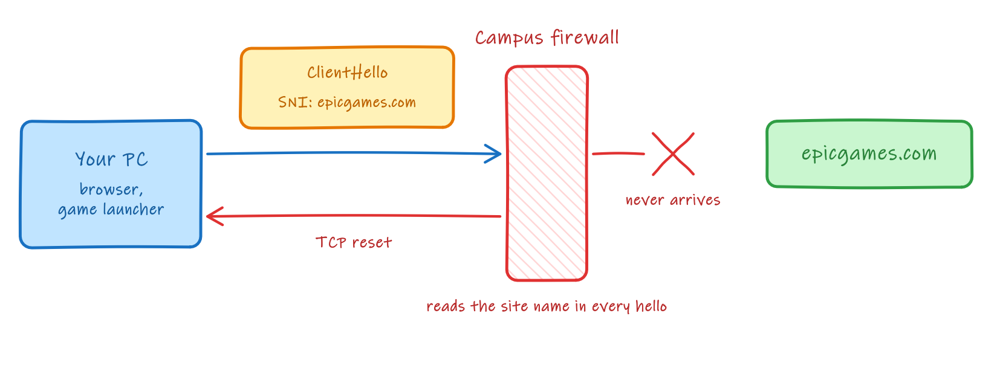

#  Sidestep

A Windows application that gets game stores (Steam, GOG, Epic, etc.) and _many other sites_ past campus firewalls (even many network provider firewalls) that block by site name (SNI). It runs GoodbyeDPI underneath, checks whether the bypass is actually working, and tunes it for your network on its own.


The app is ~1MB and written in Rust, can run installed or portable, and supports autostart. Vendor binaries are embedded, so the application is fully self-contained. Everything happens **on your device**, there's no account, no servers, and it uses very few resources.


---

## How it works

The firewall reads the site name (SNI) in the first packet of every HTTPS connection and resets the ones on its blocklist.



Sidestep sends a decoy hello with a harmless name first, then the real hello in parts, all on the same connection. The firewall judges the connection by the decoy. The server discards the decoy and joins the real parts.


The decoy is made to be discarded - a bad checksum, or a TTL short enough that it expires after the firewall but before the server. The right TTL depends on where the firewall sits on your network, so Sidestep measures it.


Every 90s, Sidestep sends a real hello for each of the test sites (configurable) through the bypass:

- reply = **passed**
- reset or silence = **blocked**
- no connection at all = **unreachable** (an IP block, which a TTL search cannot fix)

On a block, TTL search tries `--set-ttl` 1–12 and keeps the first that passes. If none do, it restores previous flags along with a warning.

Default flags: `-e 2 --reverse-frag --max-payload --wrong-chksum`.

---

## Use it

Download from the [latest release](https://github.com/Cosmic-Infinity/Sidestep/releases/latest), **First run** asks where to put things

- **Install** copies the app to a folder you pick, with an optional Start menu shortcut and an uninstall entry in _Settings > Apps_.
- **Portable** writes only to `Sidestep-data` next to the exe.

---

## Need Android?

here - [docs/android.md](docs/android.md).

---

## Build it

[Rust toolchain](https://rust-lang.github.io/rustup/installation/windows-msvc.html) for `x86_64-pc-windows-msvc`:

```sh
cargo build --release            # target/release/Sidestep.exe
```

The release build produces `target/release/Sidestep.exe`. That single binary is the whole app; share it as-is.

For testing -

```sh
cargo test --lib                 # no admin needed
cargo build --features preview   # UI-only build, no admin, never starts GoodbyeDPI
```

---

## Limitations

- **Name filtering only.** If a server's IP address is blocked, Sidestep has no effect.
- **Can break.** A firewall update can stop a working setup; the periodic check and TTL search are there to recover from that. (if it breaks, raise an issue, and I'll try to look into it)
- Currently **Windows x64 only.** (linux if there's enough demand)

---

## External Resources

- [GoodbyeDPI](https://github.com/ValdikSS/GoodbyeDPI) (ValdikSS): Apache-2.0, see `vendor/LICENSE-GoodbyeDPI.txt`
- [WinDivert](https://github.com/basil00/WinDivert) (basil00): LGPLv3 or GPLv2; used here under LGPLv3, see `vendor/LICENSE-WinDivert.txt`
- [native-windows-gui](https://github.com/gabdube/native-windows-gui): MIT
- [Fluent UI System Icons](https://github.com/microsoft/fluentui-system-icons) (Microsoft): MIT, see `icons/ui/NOTICE.txt`

---

> [!NOTE]
> Sidestep is **not** a VPN. It doesn't route your traffic through another server or add additional encryption. Your network still sees which servers you connect to, though most everyday websites sit on shared CDNs, which are impractical to block by address. Sidestep only keeps the firewall from acting on the site name, it does not bypass IP blocks. Please use responsibly.
> (P.S. unless you're in China, it's gonna be fine)


🌟<em>If Sidestep got your games downloading, please star the repo. It costs nothing, and it is the only validation I get. Thanks!</em>🌟
