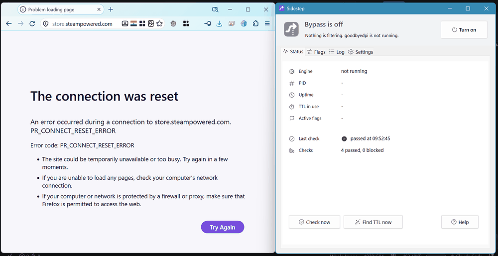
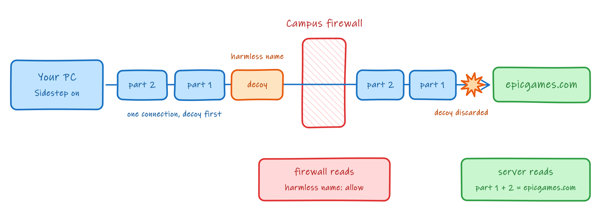
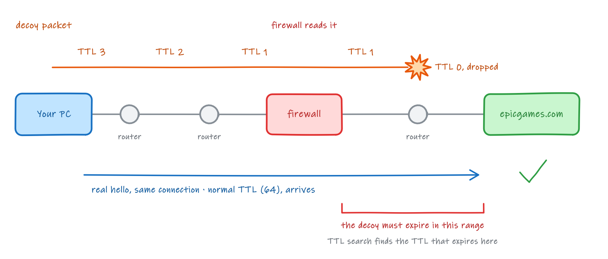

#  Sidestep

A Windows and Linux application that gets game stores (Steam, GOG, Epic, etc.) and _many other sites_ past campus firewalls (even many network provider firewalls) that block by site name (SNI). It runs GoodbyeDPI on Windows and ByeDPI on Linux underneath, checks whether the bypass is actually working, and tunes it for your network on its own.



The app is ~1MB and written in Rust, can run installed or portable, and supports autostart. Vendor binaries are embedded, so the application is fully self-contained. Everything happens **on your device**, there's no account, no servers, and it uses very few resources.


---

## How it works

The firewall reads the site name (SNI) in the first packet of every HTTPS connection and resets the ones on its blocklist.


Sidestep sends a decoy hello with a harmless name first, then the real hello in parts, all on the same connection. The firewall judges the connection by the decoy. The server discards the decoy and joins the real parts.



The decoy is made to be discarded - a bad checksum, or a TTL short enough that it expires after the firewall but before the server. The right TTL depends on where the firewall sits on your network, so Sidestep measures it.



Every 90s, Sidestep sends a real hello for each of the test sites (configurable) through the bypass:

- reply = **passed**
- reset or silence = **blocked**
- no connection at all = **unreachable** (an IP block, which a TTL search cannot fix)

On a block, TTL search tries `--set-ttl` 1–12 and keeps the first that passes. If none do, it restores previous flags along with a warning.

Default flags: `-e 2 --reverse-frag --max-payload --wrong-chksum`.

---

## Use it

Download from the [latest release](https://github.com/Cosmic-Infinity/Sidestep/releases/latest).

**Windows — first run asks where to put things:**

- **Install** copies the app to a folder you pick, with an optional Start menu shortcut
  and an uninstall entry in _Settings > Apps_.
- **Portable** writes only to `Sidestep-data` next to the exe.

**Linux — run from the terminal or install to `~/.local/bin`:**

```sh
chmod +x ./Sidestep
./Sidestep on            # start bypass and configure system SOCKS5 proxy
./Sidestep install       # optional: install to ~/.local/bin and add a desktop launcher
```

---

## Need Android?

here - [docs/android.md](docs/android.md).

---

## Build it

### Prerequisites (Linux GUI)

Standard desktop graphical libraries are required to compile the Linux GUI:

- **Debian / Ubuntu / Pop!_OS / Linux Mint:**
  ```sh
  sudo apt install libxkbcommon-dev libgl1-mesa-dev
  ```
- **Fedora / RHEL:**
  ```sh
  sudo dnf install libxkbcommon-devel mesa-libGL-devel
  ```
- **Arch Linux / Manjaro:**
  ```sh
  sudo pacman -S libxkbcommon mesa
  ```

### Compiling
```sh
# On Linux (X11 & Wayland): produces a single self-contained binary
cargo build --release            # target/release/Sidestep

# On Windows (x86_64-pc-windows-msvc or GNU):
cargo build --release            # target/release/Sidestep.exe
```

The release build produces a single self-contained binary with vendor engines embedded; share it as-is.

For testing:

```sh
cargo test --lib                 # tests flags, prober, supervision, and engine integration
cargo build --features preview   # Windows UI-only build, no admin, never starts GoodbyeDPI
```

> **Linux on non-x86_64 or packaging without vendored binaries?** See [docs/linux-ciadpi.md](docs/linux-ciadpi.md).

### Linux CLI Usage

```sh
./Sidestep on         # Start bypass, configure system SOCKS5 proxy, and verify sites
./Sidestep status     # View bypass health, PID, active TTL and flags
./Sidestep check      # Probe test sites through bypass
./Sidestep tune       # Run autonomous TTL search (1..12) to find optimal hop count
./Sidestep off        # Turn bypass off and restore direct connectivity
./Sidestep install    # Install to ~/.local/bin with desktop launcher and app icon
./Sidestep autostart enable # Configure autostart via ~/.config/autostart
```

### Linux: routing apps through the bypass

Sidestep configures your desktop's system proxy (GNOME, KDE, or a shell environment
variable via `all_proxy`) automatically. Most browsers pick this up without any changes.

Some game clients — Steam, Wine-based launchers, and Heroic — ignore the desktop proxy
and connect directly. Route them through the SOCKS5 proxy at `127.0.0.1:1080` manually:

**Steam:**

```
steam -tcp
```
Steam does not support SOCKS5 natively. Use [ProxyChains-NG](https://github.com/rofl0r/proxychains-ng)
to wrap it:
```sh
# Install proxychains-ng, then edit /etc/proxychains.conf:
# socks5  127.0.0.1  1080

proxychains4 steam
```

**Wine / Lutris / Bottles:**
```sh
export all_proxy="socks5h://127.0.0.1:1080"
wine YourGame.exe
# or for Lutris: set the env var in the game's configuration panel
```

**curl / wget (testing):**
```sh
curl --proxy socks5h://127.0.0.1:1080 https://store.steampowered.com
```

The port `1080` is the default; it can be changed in Sidestep's Flags tab with `-p <port>`.

---

## Limitations

- **Name filtering only.** If a server's IP address is blocked, Sidestep has no effect.
- **Can break.** A firewall update can stop a working setup; the periodic check and TTL search are there to recover from that. (if it breaks, raise an issue, and I'll try to look into it)
- Supports **Windows x64**, **Linux x86_64** (GUI + CLI), and other Linux architectures
  (CLI only, requires [building ciadpi from source](docs/linux-ciadpi.md)).
  Android: [docs/android.md](docs/android.md).

---

## External Resources

- [GoodbyeDPI](https://github.com/ValdikSS/GoodbyeDPI) (ValdikSS): Apache-2.0, see `vendor/LICENSE-GoodbyeDPI.txt`
- [ByeDPI](https://github.com/hufrea/byedpi) (hufrea): MIT, see `vendor/LICENSE-ByeDPI.txt`
- [WinDivert](https://github.com/basil00/WinDivert) (basil00): LGPLv3 or GPLv2; used here under LGPLv3, see `vendor/LICENSE-WinDivert.txt`
- [native-windows-gui](https://github.com/gabdube/native-windows-gui): MIT
- [Fluent UI System Icons](https://github.com/microsoft/fluentui-system-icons) (Microsoft): MIT, see `icons/ui/NOTICE.txt`

---

> [!NOTE]
> Sidestep is **not** a VPN. It doesn't route your traffic through another server or add additional encryption. Your network still sees which servers you connect to, though most everyday websites sit on shared CDNs, which are impractical to block by address. Sidestep only keeps the firewall from acting on the site name, it does not bypass IP blocks. Please use responsibly.
> (P.S. unless you're in China, it's gonna be fine)

🌟<em>If Sidestep got your games downloading, please star the repo. It costs nothing, and it is the only validation I get. Thanks!</em>🌟
