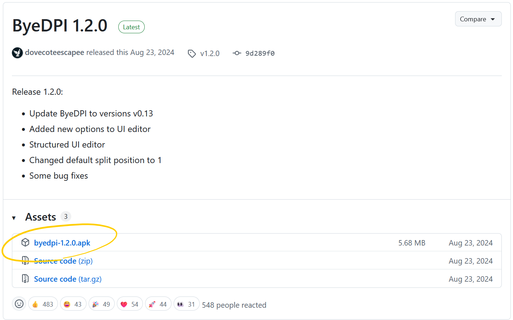
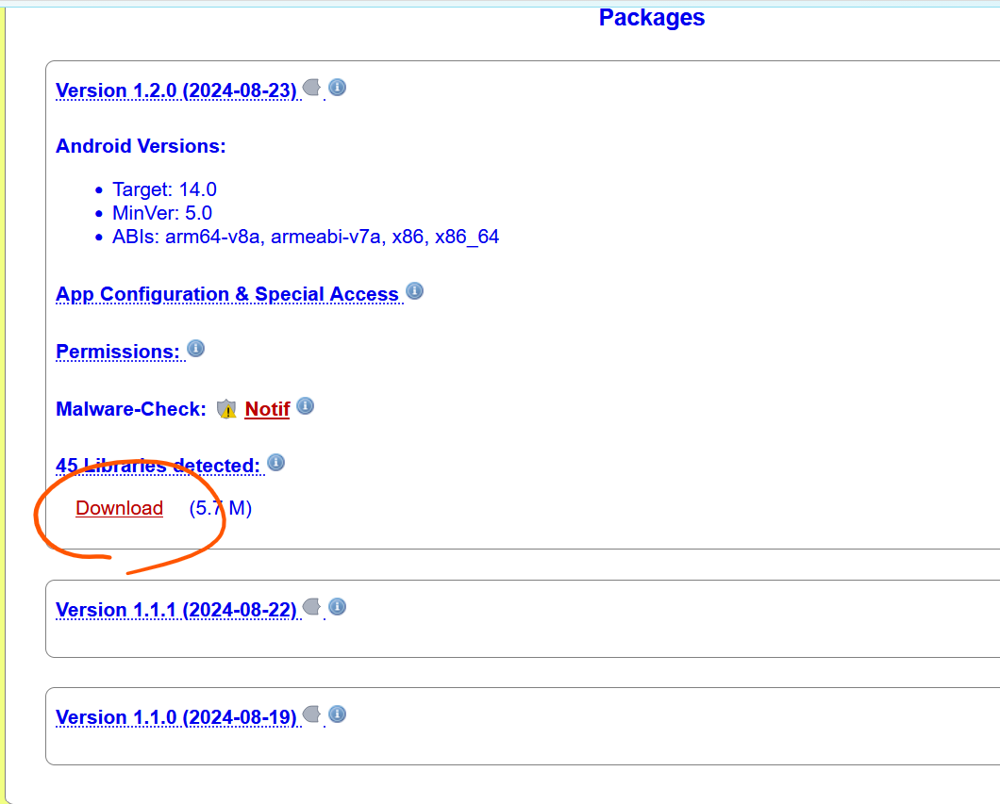
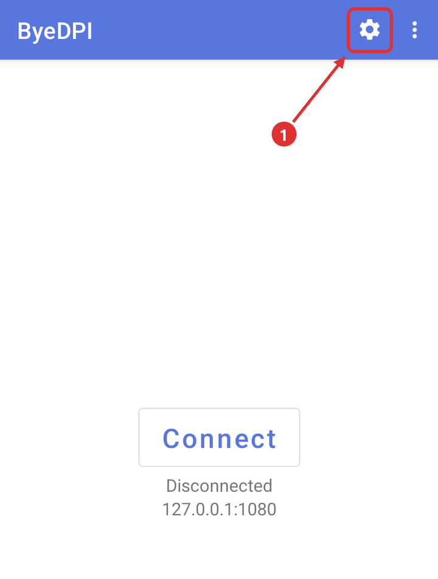
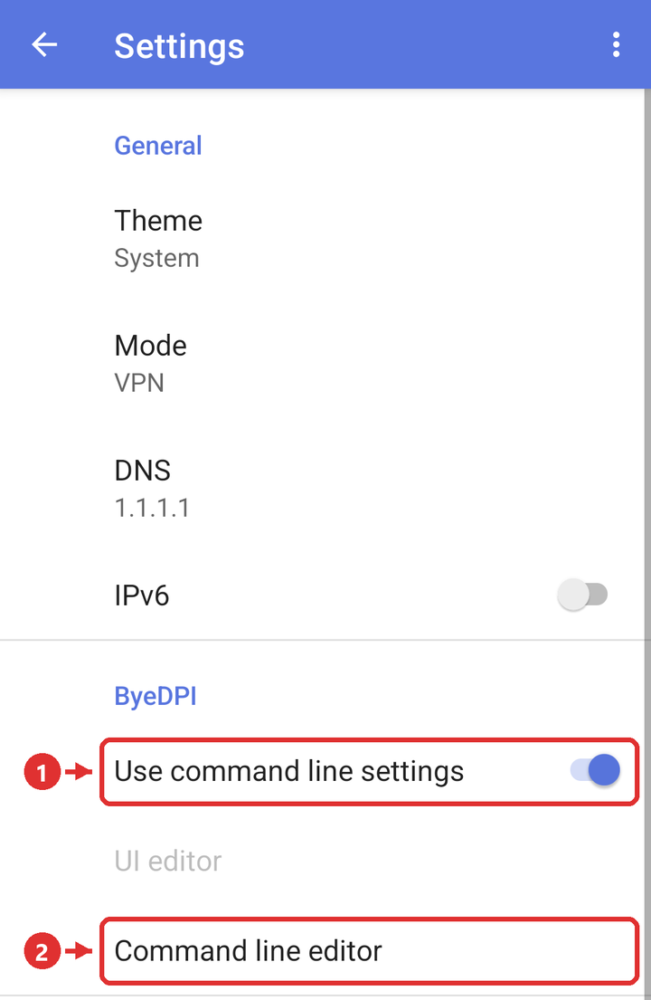
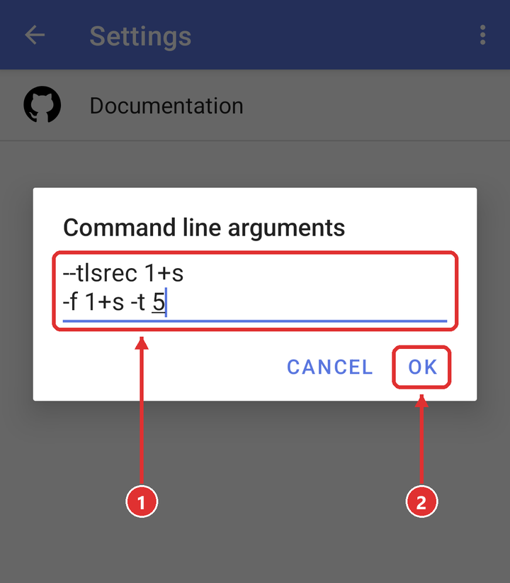
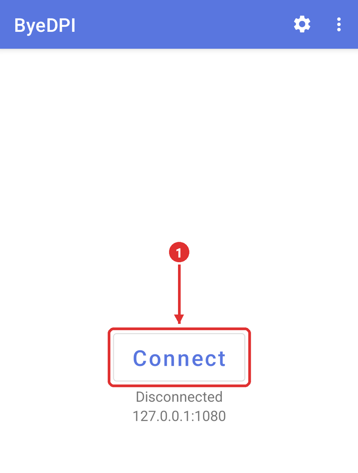
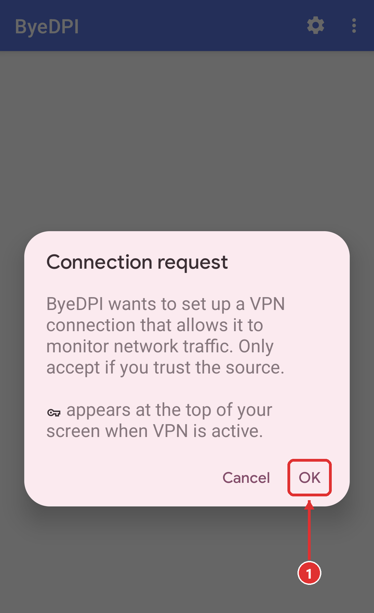
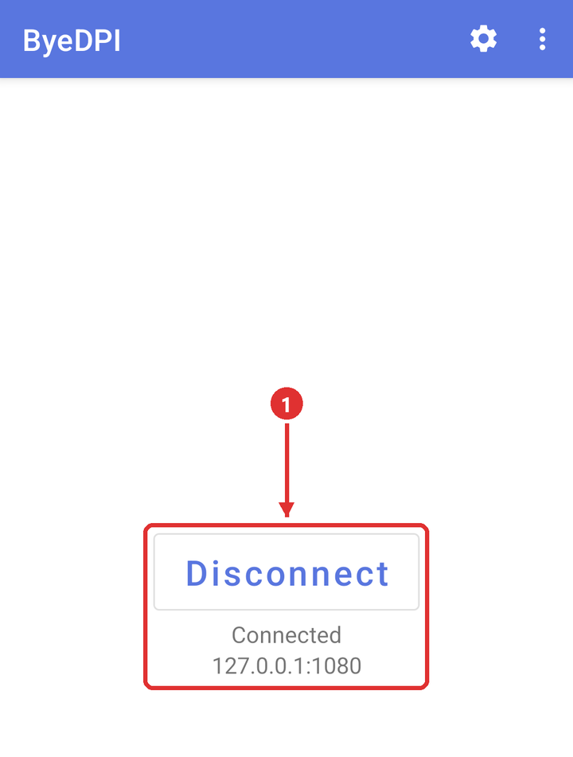

# Setting up ByeDPI on Android

[ByeDPIAndroid](https://github.com/dovecoteescapee/ByeDPIAndroid) does on your phone what Sidestep does on Windows. It needs no root and no account. It acts as a local VPN, so your traffic is reshaped on the phone and goes straight out, no intermediates.

## 1. Install

Get it from either:

- **[GitHub Releases](https://github.com/dovecoteescapee/ByeDPIAndroid/releases)**:
  download the latest `.apk` on your phone and install it. If Android blocks the install, allow your browser to _install unknown apps_.


**OR**

- **[IzzyOnDroid](https://apt.izzysoft.de/fdroid/index/apk/io.github.dovecoteescapee.byedpi)**
  (F-Droid repository): add the IzzyOnDroid repo in your F-Droid client (or you can get the apk directly), then install ByeDPI from there.


## 2. Enter the settings

**1.** Open ByeDPI and tap the **settings** icon.



**2.** Turn on **Use command line settings** (1), then tap **Command line editor** (2).



**3.** Paste this line given below (1) and tap **OK** (2):

```
--tlsrec 1+s -f 1+s -t 5
```



These flags -

| Flag           | Does                                                                                          |
| -------------- | ------------------------------------------------------------------------------------------------------ |
| `--tlsrec 1+s` | Splits the TLS record one byte into the site name, so the firewall never sees the name whole.          |
| `-f 1+s -t 5`  | Sends a decoy at the same point with a TTL of 5, so it passes the firewall and expires before the server. (Even if it does reach the server, it'll be rejected anyways because of mangled checksum, so it's fine) |

## 3. Connect

**1.** Go back to the main screen and tap **Connect**.



**2.** If it's the first time (which it will be), Android asks to allow a VPN connection. Tap **OK**.



> [!NOTE]
> **Why?** Without root, the only way an Android app can touch other apps' traffic is through Android's VPN. ByeDPI uses it as a local VPN so, it acts as a virtual network interface that hands your traffic to ByeDPI's proxy, running on the phone at `127.0.0.1:1080` (the address shown on the main screen). The proxy splits the hello, adds the decoy, and sends everything out over your normal Wi-Fi or mobile data. There is no remote server and no tunnel.

**3.** The status changes to **Connected**, and a key icon appears in the status bar while it's on. Open a site that was blocked to check it works.



## If something doesn't work

- **A site still won't load.** The TTL of 5 fits our campus network. On another network, try values from 3 to 8 in `-t`.
- **Another VPN is on.** Android allows only one VPN at a time, so ByeDPI turns off any other VPN app, and the other way round.
- **Some sites load but not others.** If a site's address itself is blocked (eg. Cloudflare Warp and ProtonVPN's public addresses are IP blocked on our campus network), ByeDPI can't help for that, same as Sidestep. I haven't really found any more major IP blocks so far (_eg. reddit mobile seems to suffer from a similar IP block but the website is accessible_), so it shouldn't really matter much.


_Enjoy_

_And leave me a_ 🌟 _on the repo. Thanks!_ :)